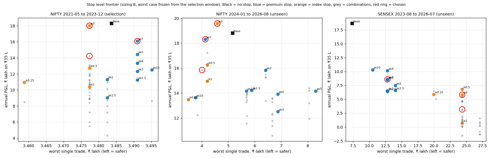

# Stops, wings and sizing for the option paper book — intraday study (2026-10-21)

**Verdict: DROP all seven variants. None passes the pre-registered rule, so the paper rule stays the naked strangle and its size is set by a worst-case budget, not by margin.**
- Wings cut the worst trade by more than half (condition 1 passes) but give up 80–90 % of the P&L at the same worst-case budget (condition 2 fails by a wide margin).
- Stops (premium or index) do not cut the worst trade at all (the worst losses are gaps, and a stop fills at the gap) and halve the P&L (both conditions fail).
- Exploratory addendum, "what stop level should it have been?": **no stop level does both on unseen data.** The level the selection window picks (premium 7x, or index stop at the strike) is almost "no stop", and it does not protect the unseen half.
- Nothing here changes the live paper rule, weights, picks or cron. Read-only research; the code is `tools/option_intraday_study.py` and `tools/option_stop_grid.py`.

Pre-registration (fixed before any result): [option-stops-wings-preregistration-2026-10](option-stops-wings-preregistration-2026-10.md), including its addendum. Frontier chart: `docs/studies/option-stop-frontier-2026-10.png`.

## Background, in plain words

- **Strangle.** Sell one call and one put on an index, both far from today's level. We collect their prices (the **credit**) and keep it if the index ends between the two strikes at expiry. The paper book sells NIFTY and SENSEX weekly strangles two trading days before expiry and holds them to expiry.
- **Delta (0.05).** Roughly the market's chance that the option finishes in the money; 0.05 means about 5 %. We pick the strikes whose delta is nearest 0.05 (option_book's picker, on that day's end-of-day chain).
- **Naked.** No protection: if the index runs through a strike we lose without limit.
- **Wing.** A cheap option bought further out (here 2 %, 3 % or 4 % of the index beyond each sold strike). It caps the loss at the gap between the sold strike and the wing, minus the credit. A strangle with both wings is an iron condor.
- **Stop.** A rule to exit early. A *premium stop* buys a leg back when its price reaches k times what we sold it for (k = 2 means it doubled). An *index stop* closes both legs when the index comes within 0.5 % of a sold strike.
- **Gap-through.** The market opens beyond the stop. You cannot exit at the stop price; you exit at the open, which is worse. Wide gaps are why stops do not cap the worst loss.
- **Whipsaw.** A stop that fires, and the position would have expired worthless (a win) if left alone. The stop turned a win into a loss.
- **Margin.** Cash the broker blocks to hold the position. Naked: 12 % of the index value (as the paper book). Hedged: the most you can lose plus 2 % of the index value as exposure margin on each sold leg.
- **Sizing A.** As many lots as the margin allows on ₹35 L. **Sizing B.** As many lots as keep the worst case inside ₹3.5 L (10 % of capital): for wings the worst case is exact (width minus credit); for naked and stop variants it is the worst loss seen in the sample (see "What I had to interpret").
- **Drawdown.** The biggest fall from a cumulative-profit peak. **Sharpe.** Average weekly profit divided by its weekly variation, scaled to a year; above 2 is good in a short, calm sample, and this sample has no crash.

## Method (as pre-registered)

- Entry: the paper book's strikes (0.05 delta from that day's chain), entered at the **average of the 1-minute closes stamped 15:20–15:29** on the entry day. The baseline is also shown at the exchange's 15:00–15:30 VWAP close (what the paper book uses today).
- Costs: `option_book.leg_cost` (1 % slippage per leg per side, brokerage, exchange charge, STT, stamp); a stop pays an exit; a wing finishing in the money pays STT on exercise. Settlement: intrinsic value on the expiry-day index in fno_bhav, as the paper book.
- Lot size: the contract's own lot (`option_book.CONTRACT_LOTS`, below). Lots change the rupee scale only: under both sizings the number of lots moves the other way, so percentages and ratios are unaffected.
- Data: NIFTY expiries 2021-05-27 → 2026-08-04, SENSEX 2023-08-11 → 2026-07-30 (Hugging Face 1-minute archive), strike picking needs the fno_bhav chain (SENSEX history starts 2024-01-05, so SENSEX trades start in 2024-01).

### Coverage

| | NIFTY | SENSEX |
|---|---|---|
| Expiries with an entry day in range | 274 | 139 |
| No file in the archive (missing expiries) | 8 | 14 |
| Stub file (skipped) | 1 (2026-06-09) | 1 (2026-07-23) |
| Suspect file (VWAP match < 90 %) | 0 | 0 |
| Skipped: short leg did not print on the entry day / not in file / no chain | 5 / 1 / 1 | 2 / 1 / 1 |
| **Trades used** | **258** | **120** |
| Wings 2 % / 3 % / 4 % have a priced wing on both sides | 255 / 254 / 250 | 120 / 94 / 77 |

Every wing variant is compared with the baseline **on its own trades**. SENSEX wing 3 % and 4 % lose a quarter and a third of the trades (no print on the far strike that day): treat their SENSEX numbers as thinner. One NIFTY trade entered at the last print before 15:20 (no print inside the window).

## Entry-price effect (VWAP close vs 15:20–15:29 average)

| | Mean credit, VWAP | Mean credit, 15:20–15:29 | Mean net per trade, VWAP | Mean net per trade, window |
|---|---|---|---|---|
| NIFTY (258) | 12.62 pts | 12.33 pts (−2.3 %) | 9.62 pts | 9.33 pts |
| SENSEX (120) | 48.73 pts | 48.04 pts (−1.4 %) | 36.16 pts | 35.47 pts |

Annual P&L, sizing A, NIFTY alone: ₹683,729 (VWAP) vs ₹661,472 (window), 3.3 % lower; combined book ₹489,573 vs ₹475,751 (2.8 % lower). The exchange VWAP flatters the sold price a little (the late-session average is lower than the day's closing VWAP); the effect is small and the same sign in both indices. The window price is the tradable one and is used for every variant.

## Results: the pre-registered variants

Full tables (every variant × sizing × underlying and combined, all pre-registered metrics) are in Appendix A. The decision rule, sizing B, each variant against the baseline **on the same trades**:

| Variant | Book | Worst-trade ratio (need ≤ 0.50) | Annual P&L ratio (need ≥ 0.70) | Mean > 0 in 2021–23 and 2024–26 | Pass |
|---|---|---|---|---|---|
| Premium stop 2x | combined | 1.12 | 0.43 | yes | no |
| Premium stop 3x | combined | 1.12 | 0.42 | yes | no |
| Index stop 0.5 % | combined | 2.16 | 0.50 | yes | no |
| Wings 2 % | combined | 0.37 | 0.19 | yes | no |
| Wings 3 % | combined | 0.18 | 0.15 | yes | no |
| Wings 4 % | combined | 0.14 | 0.11 | yes | no |
| Wings 3 % + premium stop 3x | combined | 0.31 | −0.01 | **no** (SENSEX 2024–26 negative) | no |

Per underlying (NIFTY / SENSEX): same picture. NIFTY: stops 0.64–1.01 worst, 0.48–0.57 P&L; wings 0.11–0.30 P&L. SENSEX: stops 1.11 (index stop 2.13) worst, 0.26–0.29 P&L; wings 0.20–0.29 P&L. No variant passes in either book. (Source: the "Decision rule" block in Appendix A.)

- **Condition 1, worst trade ≤ half the baseline's:** passed by every wing variant and by none of the stops. Stop losses are not capped by a stop (see the next table: 26 gap fills in the combined book for the 2x stop); the worst NIFTY loss (2026-05-12, index −3.47 %) and the worst SENSEX loss (2024-10-04, −3.24 %) are both two-day gap-and-run moves.
- **Condition 2, keep ≥ 70 % of the baseline's P&L:** failed by all. Wings keep about 85–90 % of the P&L *per lot* (sizing A) but, to hold the same ₹3.5 L worst case, the wing book can only be sized by its exact worst case (width minus credit, several times the baseline's observed worst loss per lot), so it runs far fewer lots. Stops halve the return per trade because 20–45 % of trades are whipsawed.
- **Condition 3, positive in both regimes:** holds for everything except wings 3 % + stop 3x.

### Stops: how often, whipsaw and cost (sizing B)

| Variant | Trades | Stop fired | Fired % | Gap fills | Whipsaw trades | Whipsaw % | Whipsaw cost vs holding ₹ | Fired but hold won |
|---|---|---|---|---|---|---|---|---|
| Premium 2x, NIFTY | 258 | 112 | 43.4 | 18 | 100 | 38.8 | 3,367,360 | 102 |
| Premium 2x, SENSEX | 120 | 58 | 48.3 | 8 | 54 | 45.0 | 1,715,784 | 55 |
| Premium 3x, NIFTY | 258 | 68 | 26.4 | 12 | 56 | 21.7 | 3,310,087 | 58 |
| Premium 3x, SENSEX | 120 | 39 | 32.5 | 4 | 35 | 29.2 | 1,681,105 | 36 |
| Index 0.5 %, NIFTY | 258 | 68 | 26.4 | 9 | 56 | 21.7 | 2,688,175 | 58 |
| Index 0.5 %, SENSEX | 120 | 28 | 23.3 | 3 | 24 | 20.0 | 1,628,444 | 25 |

A premium stop of 2x fires on 43–48 % of trades and in about 9 of 10 of those firings the unstopped trade would have won. Far-out options routinely spike for minutes and fall back.

### Wings: nothing was ever exercised in this sample

| Variant | Trades | Wing finished in the money | Wings premium (pts) | Short credit (pts) | Worst-case bound (pts) | Hedged margin (pts) |
|---|---|---|---|---|---|---|
| Wings 2 %, NIFTY | 255 | 0 | 3.76 | 11.99 | 435 | 1,265 |
| Wings 3 %, NIFTY | 254 | 0 | 2.86 | 11.95 | 640 | 1,470 |
| Wings 4 %, NIFTY | 250 | 0 | 2.28 | 11.74 | 847 | 1,675 |
| Wings 2 %, SENSEX | 120 | 0 | 10.99 | 48.04 | 1,661 | 4,808 |
| Wings 3 %, SENSEX | 94 | 0 | 8.10 | 48.08 | 2,493 | 5,664 |
| Wings 4 %, SENSEX | 77 | 0 | 6.20 | 48.04 | 3,290 | 6,494 |

The wings cost 19–31 % of the credit and in five years never paid out: the largest settle move was 3.5 %, and the wings sit about 4–6 % from the index. A wing in this sample is pure insurance cost. That says nothing about 2020-03 or June 2024 (see "What would falsify this").

**Wing price caveat (sensitivity, not pre-registered).** Wings are priced at the last 1-minute closes, which for far strikes can be below what you would pay (thin books). Paying twice the printed wing premium, combined, sizing B: Wings 2 % earns ₹31,659 a year (0.9 % of capital), Wings 3 % ₹46,841, Wings 4 % ₹40,924, against ₹707,682 for the baseline; the conclusion (condition 2 fails) only gets worse.

### P&L by year, combined, sizing B (₹)

| Year | Baseline | Prem 2x | Prem 3x | Index 0.5 % | Wings 2 % | Wings 3 % | Wings 4 % | Wings 3 % + 3x |
|---|---|---|---|---|---|---|---|---|
| 2021 | 245,265 | 107,740 | 127,032 | 225,597 | 37,633 | 31,964 | 28,296 | −1,362 |
| 2022 | 538,272 | 272,420 | 235,558 | 263,092 | 108,713 | 86,939 | 67,280 | 3,185 |
| 2023 | 360,352 | 80,487 | 199,466 | 83,286 | 54,267 | 43,231 | 35,825 | 3,398 |
| 2024 | 823,277 | 314,283 | 384,635 | 466,293 | 134,027 | 73,438 | 37,208 | −25,154 |
| 2025 | 1,052,775 | 512,407 | 479,270 | 330,321 | 225,894 | 155,142 | 118,301 | 14,762 |
| 2026 | 535,919 | 236,837 | 66,581 | 394,308 | 96,523 | 75,261 | 46,720 | −15,441 |

No losing year for the baseline or any stop/wing variant except Wings 3 % + 3x (three losing years). 2021 and 2026 are part years.

### Worst baseline trades

| Underlying | Entry | Expiry | Index move to settle % | Net pts | 1 lot ₹ |
|---|---|---|---|---|---|
| SENSEX | 2024-10-01 | 2024-10-04 | −3.24 | −774.9 | −7,749 |
| NIFTY | 2026-05-08 | 2026-05-12 | −3.47 | −155.9 | −10,132 |
| SENSEX | 2024-12-18 | 2024-12-20 | −2.77 | −101.0 | −1,010 |
| NIFTY | 2022-07-26 | 2022-07-28 | +2.65 | −71.8 | −3,591 |

## Amit's practical question: ₹35 L, naked vs the best variant

"Best variant" is not defined by the rule (none passes). I take **wings 2 %**: the variant with the highest annual P&L among those that cut the worst trade by more than half. For reference, the best non-wing, the index stop, is in Appendix A.

| ₹35 L | Sizing | Annual P&L | Worst trade | Max drawdown |
|---|---|---|---|---|
| Naked baseline, NIFTY alone | A (fill margin) | ₹661,472 | −₹182,371 | −₹182,371 |
| Naked baseline, NIFTY alone | B (₹3.5 L budget) | ₹1,053,812 | −₹344,479 | −₹344,479 |
| Wings 2 %, NIFTY alone | A | ₹574,694 | −₹376,005 | −₹376,005 |
| Wings 2 %, NIFTY alone | B | ₹163,325 | −₹104,446 | −₹104,446 |
| Naked baseline, NIFTY + SENSEX at ₹17.5 L each | A | ₹475,751 | −₹131,729 | −₹131,729 |
| Naked baseline, NIFTY + SENSEX | B | ₹707,682 | −₹172,239 | −₹172,239 |
| Wings 2 %, NIFTY + SENSEX | A | ₹469,559 | −₹252,313 | −₹252,313 |
| Wings 2 %, NIFTY + SENSEX | B | ₹130,766 | −₹63,078 | −₹63,078 |

How to read it:
- **Naked sizing B is not a real cap.** It sizes lots so that the worst loss *seen in 2021–26* is ₹3.5 L. A naked strangle's loss is not bounded by what was seen; the feasibility study's stress model puts the worst week (2020-03-11) at −35 % to −36 % of margin, many times any loss in this sample. The naked B column is the optimistic figure.
- **Wings sizing B is a real cap** (width minus credit, plus costs): the worst trade here (−₹104,446 NIFTY) is far inside the ₹3.5 L, because no wing was ever hit; in a trade that runs through a wing the loss would be near the ₹3.5 L budget (the bound), not above it.
- **Wings sizing A is dangerous**: the margin is so small that the sized-A book carries more lots and a larger worst trade (−₹376,005) than the naked book.
- The wings give a safe, small return (₹1.6 lakh a year NIFTY alone, 4.7 % of capital); the naked strangle gives a bigger return with an unbounded tail. That is the trade-off, stated in numbers.

## Exploratory addendum: what stop level "should have been"?

EXPLORATORY and walk-forward, reported apart from the verdict above (pre-registration addendum). Premium stops k ∈ {1.5, 2, 2.5, 3, 4, 5, 7, 10}, index stops d ∈ {0, 0.25, 0.5, 1.0} % from a short strike, and the 32 combinations (each leg exits at whichever stop fires first). **Chosen on NIFTY 2021-05 → 2023-12 only** (133 trades), by highest annual P&L at sizing B, ties to the wider stop; then reported untouched on NIFTY 2024-01 → 2026-08 (125 trades) and on all SENSEX (120 trades, never used to choose).

Sizing B in this section: each stop's worst-case budget is its **own worst loss in the selection window, as a share of the index value, frozen** and applied to the unseen windows (the walk-forward reading: you would have set size from what you had seen). "B-own" re-measures the worst case inside each window (hindsight) for comparison. Every grid point, all three windows, sizing A, B and B-own, fired % and whipsaw %, and the points given up versus no stop are in Appendix B.

**Chosen on the selection window:** premium stop **7x** (annual ₹1,608,468 at B, 11.3 % of trades fired), index stop **at the strike (d = 0)** (₹1,801,730, 8.3 % fired), and the combination 7x + strike (₹1,423,692). The no-stop baseline on the selection window earned ₹1,828,894 at B, so on the selection data the best stop is within a few percent of having no stop at all; every other level gives up between a third and a half of the return.

Unseen results, ₹35 L, sizing A / sizing B (selection worst case frozen):

| Window | Variant | A annual | A worst | A max DD | B annual | B worst | B max DD |
|---|---|---|---|---|---|---|---|
| Selection (in-sample), NIFTY 2021-05→2023-12 | no stop | ₹657,146 | −₹125,699 | −₹125,699 | ₹1,828,894 | −₹348,367 | −₹348,367 |
| | premium 7x | ₹419,491 | −₹91,069 | −₹102,230 | ₹1,608,468 | −₹349,100 | −₹395,101 |
| | index at strike | ₹477,795 | −₹92,729 | −₹92,729 | ₹1,801,730 | −₹347,735 | −₹347,735 |
| Unseen, NIFTY 2024-01→2026-08 | no stop | ₹669,866 | −₹182,371 | −₹182,371 | ₹1,879,673 | −₹516,718 | −₹516,718 |
| | premium 7x | ₹473,484 | −₹105,002 | −₹139,053 | ₹1,830,831 | −₹413,830 | −₹546,029 |
| | index at strike | ₹515,233 | −₹121,804 | −₹121,804 | ₹1,957,721 | −₹459,109 | −₹459,109 |
| | 7x + strike | ₹417,007 | −₹105,002 | −₹142,715 | ₹1,584,955 | −₹401,477 | −₹545,676 |
| Unseen, SENSEX 2024-01→2026-07 | no stop | ₹668,446 | −₹263,458 | −₹263,458 | ₹1,863,663 | −₹736,134 | −₹736,134 |
| | premium 7x | ₹223,374 | −₹333,253 | −₹386,141 | ₹858,108 | −₹1,280,392 | −₹1,483,424 |
| | index at strike | ₹155,175 | −₹642,550 | −₹707,168 | ₹581,963 | −₹2,434,925 | −₹2,687,095 |
| | 7x + strike | ₹84,748 | −₹642,550 | −₹705,677 | ₹317,258 | −₹2,434,925 | −₹2,673,685 |

Verdict against the bar (unseen worst ≤ half of no-stop worst AND ≥ 70 % of no-stop annual P&L at equal worst-case budget), unseen NIFTY, sizing B with the frozen worst case:

| Chosen stop | Worst vs no stop (need ≤ 0.50) | Annual vs no stop (need ≥ 0.70) | Result |
|---|---|---|---|
| Premium 7x | 0.80 | 0.97 | fail |
| Index at strike | 0.89 | 1.04 | fail |
| 7x + strike | 0.78 | 0.84 | fail |

On SENSEX the same stops are worse (worst ratio 1.74 / 3.31 / 3.31, annual 0.46 / 0.31 / 0.17). With the hindsight sizing (B-own) the worst-trade ratio is 0.96–1.01 everywhere: a stop does not shrink the worst trade. **No stop level does both on unseen data.**

What the grid shows, plainly:
- The stops that keep the profit are the ones that almost never fire (7x, strike touched: 8–11 % of trades), so they also do not protect: the worst NIFTY trade (2026-05-12) gapped, and the stop filled at the gap.
- The stops that fire often (1.5x–3x, index 0.25–1 %) protect the small losses and give up 30–55 % of the return to whipsaw (whipsaw 15–59 % of trades in the selection window).
- The frozen "worst case" itself failed: on the selection window the largest loss was 0.44 % of the index value per trade, and sizing from that put the no-stop book at a worst trade of −₹516,718 on the unseen half (budget ₹3.5 L; about 48 % over). A stop does not fix that, and neither does an in-sample worst case; only a structural cap (wings) or a smaller size does.

## What I had to interpret (where the pre-registration is silent or impossible)

1. **Sizing B for unhedged variants.** The pre-registration says "the 2021–26 worst observed loss per lot". For the main verdict I used the baseline's worst observed loss per unit (as points, converted with each trade's own lot) for **every** unhedged variant, so all of them risk the same budget and the stop's effect is visible. Sizing each variant by its own worst would make every unhedged variant's worst trade ≈ ₹3.5 L by construction and condition 1 unpassable. In the addendum (explicitly "own worst, frozen") the reading is each stop's own selection-window worst.
2. **Hedged margin.** Max loss per lot (worst of the two widths minus the net credit) + 2 % of notional **on each of the two short legs** (literal "on the short legs"; `--elm-legs 1` charges it once). Sizing B and all ratios do not depend on it; sizing A for wings does. The Kite basket check **could not run (no login) and is pending for the next entry day**; if the quote differs by more than 25 % the hedged margin should be re-scaled.
3. **Sessions.** The entry day is two sessions before expiry on the fno_bhav NIFTY calendar (market_holidays only starts 2026-01).
4. **Bars exist only for traded minutes.** "A session opens above the stop" = the leg's first print of the session opens at or above the stop (fill at that open). Entry price: average of the closes stamped 15:20–15:29; the last print before 15:20 when none (1 trade). A wing is the nearest listed strike at or beyond the target that printed on the entry day; a trade with no such strike is dropped from that variant (and compared against the baseline on the same trades).
5. **Index stop fills.** Each leg exits at its last print at or before the trigger minute (its first print of the session on a gap), never below intrinsic value at the trigger index level. Stale last prints on thin legs flatter this variant; it still lost.
6. **Strike pick uses the whole-day fno_bhav chain** (as the paper book), a 10-minute look-ahead relative to a 15:20 entry; the 0.05-delta strike is stable over that span, but it is not a strict as-of pick.
7. **Premium stops use closes only.** An intrabar spike whose close is back under the stop does not fire.
8. **Index file ends 2026-07-02**: any index-stop expiry beyond that is dropped from the index stop (the coverage counter shows none lost in the used trades).
9. **Sharpe** is on weekly P&L over calendar weeks (weeks with no trade count as zero); "annual P&L" = total / years from first entry to last expiry; "worst trade" and "max drawdown" are on the trade sequence by expiry date.

## Lot sizes

`option_book.lot_size(underlying, d)` picks the lot by trade date; a contract keeps the lot it was listed with, so it is wrong for contracts that straddle a revision. Fixed in two commits: `lot_size(underlying, d, expiry=None)` plus `CONTRACT_LOTS`, nine expiries read off the ingest notes and checked against fno_bhav contract counts: NIFTY 2021-07-01/08/15/22 (75), 2024-12-26 (25), 2025-01-30 (25), 2025-12-30 (75); SENSEX 2025-01-03 (10), 2025-01-28 (10). The paper book now passes the expiry. **None of the paper book's four trades (NIFTY 2026-10-13 and 2026-10-19, SENSEX 2026-10-15 and 2026-10-22) used a wrong lot** (none is in a revision window; the lot is unchanged by the fix). Unresolved: two mixed-lot ingest files (NIFTY 2024-05-02 and 2025-09-30) agree with the by-date table at the entry day and were left alone. The next lot revision needs a row in `CONTRACT_LOTS`.

## What would falsify this / what this cannot say

- **Wings were never exercised in 258 + 120 trades.** The study shows their price, not their payout. A single 5 %+ move through both the short and the wing is what they are for; this window has none (largest settle move −3.5 %), and the 2020-03 crash and June 2024 election day are not in the intraday data (2021-05 onward).
- **A variant that passed would have to be re-run on the stress model** (`tools/option_premium_backtest`, 2015–2026 including 2020-03-11). It was **not run: nothing passed.** For the record, that model works on daily closes and India VIX (strike distance and credit in VIX × √T units): it can represent a naked strangle and, only roughly, a 1 % condor; it cannot represent a stop (no intraday path, no gaps within a day) or wings other than 1 %.
- What would change the answer: a wing price floor lower than printed (cheaper wings), a longer sample with a real crash, or measuring live bid/ask on far wings (the paper book's Kite shadow already records bid/ask on the shorts only).
- Stop whipsaw depends on 1-minute closes of thin far-out options; a tighter data quality filter on spikes (volume at the trigger bar) could soften it. Not tested.

## Multiple-testing caveat

Pre-registered: seven candidate variants (premium 2x, 3x; index; wings 2, 3, 4 %; wings 3 % + 3x) × two sizings × three books, against one decision rule with three conditions. None passed, so no haircut is needed. The exploratory addendum adds a grid of 44 stop settings (8 + 4 + 32) searched on 133 trades; its "best" stop (premium 7x or strike touched) is effectively no stop, within noise of the baseline on the selection data, and would need a heavy haircut to claim anything. Reported for the question asked, not as evidence for any stop.

## Files, tests

- `tools/option_intraday_study.py` (variants, fills, sizing, report; `--variant`, `--underlying`, `--report`, `--extras`, `--smoke`).
- `tools/option_stop_grid.py` (exploratory stop-level grid and chart).
- `tests/test_option_intraday_study.py` (premium stop with gap-through, index stop, wings payoff at expiry, sizing A/B, decision rule, grid choice).
- `option_book.py`, `tests/test_option_book.py` (per-contract lot fix).
- `docs/studies/option-stop-frontier-2026-10.png` (frontier chart).

Reproduce: `python -m tools.option_intraday_study --underlying both --variant all --extras` and `python -m tools.option_stop_grid --chart docs/studies/option-stop-frontier-2026-10.png` (about 5 and 25 minutes).

## Appendix A: every pre-registered variant, raw tool output

Sizing A = fill margin; B = ₹3.5 L worst-case budget; on ₹35 L (NIFTY and SENSEX alone; COMBINED = ₹17.5 L each). Triggered = stop fired or wing finished in the money; Whipsaw = stopped legs that would have expired worthless.

### NIFTY, sizing A

| Variant | Trades | Win % | Mean/trade ₹ | Mean % margin | Annual ₹ | Annual % cap | Sharpe | Worst ₹ | Worst % cap | Max DD ₹ | Losing yrs | Triggered | Whipsaw |
|---|---|---|---|---|---|---|---|---|---|---|---|---|---|
| baseline_vwap | 258 | 96.1 | 13,316 | 0.39 | 683,729 | 19.5 | 5.17 | -180,902 | -5.2 | -180,902 | 0 | 0 | 0 |
| baseline | 258 | 96.1 | 12,882 | 0.38 | 661,472 | 18.9 | 5.03 | -182,371 | -5.2 | -182,371 | 0 | 0 | 0 |
| pstop2 | 258 | 63.6 | 6,181 | 0.18 | 317,367 | 9.1 | 2.60 | -149,171 | -4.3 | -153,103 | 0 | 112 | 101 |
| pstop3 | 258 | 73.6 | 6,233 | 0.18 | 320,059 | 9.1 | 2.06 | -174,238 | -5.0 | -259,691 | 0 | 68 | 57 |
| istop | 258 | 82.6 | 7,390 | 0.22 | 379,433 | 10.8 | 2.49 | -110,046 | -3.1 | -147,759 | 0 | 68 | 56 |
| wing2 | 255 | 96.1 | 11,324 | 0.33 | 574,694 | 16.4 | 2.35 | -376,005 | -10.7 | -376,005 | 0 | 0 | 0 |
| wing3 | 254 | 96.1 | 11,787 | 0.34 | 595,834 | 17.0 | 2.80 | -320,445 | -9.2 | -320,445 | 0 | 0 | 0 |
| wing4 | 250 | 96.0 | 11,069 | 0.32 | 550,749 | 15.7 | 2.99 | -277,755 | -7.9 | -277,755 | 0 | 0 | 0 |
| wing3_pstop3 | 254 | 73.6 | 696 | 0.02 | 35,187 | 1.0 | 0.14 | -322,579 | -9.2 | -466,689 | 3 | 67 | 56 |

### NIFTY, sizing B

| Variant | Trades | Win % | Mean/trade ₹ | Mean % margin | Annual ₹ | Annual % cap | Sharpe | Worst ₹ | Worst % cap | Max DD ₹ | Losing yrs | Triggered | Whipsaw |
|---|---|---|---|---|---|---|---|---|---|---|---|---|---|
| baseline_vwap | 258 | 96.1 | 21,153 | 0.39 | 1,086,118 | 31.0 | 4.88 | -341,704 | -9.8 | -341,704 | 0 | 0 | 0 |
| baseline | 258 | 96.1 | 20,523 | 0.38 | 1,053,812 | 30.1 | 4.75 | -344,479 | -9.8 | -344,479 | 0 | 0 | 0 |
| pstop2 | 258 | 63.6 | 9,988 | 0.18 | 512,844 | 14.7 | 2.43 | -298,342 | -8.5 | -306,205 | 0 | 112 | 101 |
| pstop3 | 258 | 73.6 | 9,828 | 0.18 | 504,616 | 14.4 | 1.88 | -348,475 | -10.0 | -514,789 | 0 | 68 | 57 |
| istop | 258 | 82.6 | 11,766 | 0.22 | 604,139 | 17.3 | 2.36 | -220,092 | -6.3 | -295,519 | 0 | 68 | 56 |
| wing2 | 255 | 96.1 | 3,218 | 0.33 | 163,325 | 4.7 | 2.36 | -104,446 | -3.0 | -104,446 | 0 | 0 | 0 |
| wing3 | 254 | 96.1 | 2,534 | 0.34 | 128,114 | 3.7 | 2.67 | -72,359 | -2.1 | -72,359 | 0 | 0 | 0 |
| wing4 | 250 | 96.0 | 2,058 | 0.32 | 102,383 | 2.9 | 2.96 | -51,436 | -1.5 | -51,436 | 0 | 0 | 0 |
| wing3_pstop3 | 254 | 73.6 | 163 | 0.02 | 8,228 | 0.2 | 0.15 | -64,516 | -1.8 | -94,405 | 3 | 67 | 56 |

### SENSEX, sizing A

| Variant | Trades | Win % | Mean/trade ₹ | Mean % margin | Annual ₹ | Annual % cap | Sharpe | Worst ₹ | Worst % cap | Max DD ₹ | Losing yrs | Triggered | Whipsaw |
|---|---|---|---|---|---|---|---|---|---|---|---|---|---|
| baseline_vwap | 120 | 97.5 | 13,405 | 0.39 | 681,156 | 19.5 | 3.53 | -263,079 | -7.5 | -263,079 | 0 | 0 | 0 |
| baseline | 120 | 97.5 | 13,155 | 0.38 | 668,446 | 19.1 | 3.46 | -263,458 | -7.5 | -263,458 | 0 | 0 | 0 |
| pstop2 | 120 | 56.7 | 3,469 | 0.10 | 176,274 | 5.0 | 0.74 | -333,253 | -9.5 | -359,559 | 1 | 58 | 55 |
| pstop3 | 120 | 67.5 | 3,364 | 0.10 | 170,909 | 4.9 | 0.66 | -333,253 | -9.5 | -340,602 | 0 | 39 | 35 |
| istop | 120 | 83.3 | 3,549 | 0.10 | 180,317 | 5.2 | 0.40 | -642,550 | -18.4 | -704,909 | 1 | 28 | 24 |
| wing2 | 120 | 97.5 | 15,800 | 0.46 | 802,839 | 22.9 | 2.21 | -512,510 | -14.6 | -512,510 | 0 | 0 | 0 |
| wing3 | 94 | 96.8 | 15,725 | 0.46 | 625,880 | 17.9 | 2.66 | -306,253 | -8.8 | -306,253 | 0 | 0 | 0 |
| wing4 | 77 | 97.4 | 14,620 | 0.43 | 574,680 | 16.4 | 2.34 | -306,019 | -8.7 | -306,019 | 1 | 0 | 0 |
| wing3_pstop3 | 94 | 64.9 | -4,323 | -0.12 | -172,062 | -4.9 | -0.39 | -582,871 | -16.7 | -707,897 | 2 | 33 | 29 |

### SENSEX, sizing B

| Variant | Trades | Win % | Mean/trade ₹ | Mean % margin | Annual ₹ | Annual % cap | Sharpe | Worst ₹ | Worst % cap | Max DD ₹ | Losing yrs | Triggered | Whipsaw |
|---|---|---|---|---|---|---|---|---|---|---|---|---|---|
| baseline_vwap | 120 | 97.5 | 16,009 | 0.39 | 813,448 | 23.2 | 3.24 | -348,192 | -9.9 | -348,192 | 0 | 0 | 0 |
| baseline | 120 | 97.5 | 15,706 | 0.38 | 798,062 | 22.8 | 3.17 | -348,695 | -10.0 | -348,695 | 0 | 0 | 0 |
| pstop2 | 120 | 56.7 | 4,342 | 0.10 | 220,628 | 6.3 | 0.79 | -385,872 | -11.0 | -422,291 | 0 | 58 | 55 |
| pstop3 | 120 | 67.5 | 4,152 | 0.10 | 210,981 | 6.0 | 0.70 | -385,872 | -11.0 | -394,381 | 0 | 39 | 35 |
| istop | 120 | 83.3 | 4,537 | 0.10 | 230,538 | 6.6 | 0.44 | -744,005 | -21.3 | -819,265 | 1 | 28 | 24 |
| wing2 | 120 | 97.5 | 4,627 | 0.46 | 235,119 | 6.7 | 2.44 | -134,041 | -3.8 | -134,041 | 0 | 0 | 0 |
| wing3 | 94 | 96.8 | 3,690 | 0.46 | 146,885 | 4.2 | 3.63 | -47,116 | -1.3 | -47,116 | 0 | 0 | 0 |
| wing4 | 77 | 97.4 | 2,877 | 0.43 | 113,079 | 3.2 | 2.89 | -47,080 | -1.3 | -47,080 | 1 | 0 | 0 |
| wing3_pstop3 | 94 | 64.9 | -912 | -0.12 | -36,306 | -1.0 | -0.39 | -123,639 | -3.5 | -145,721 | 3 | 33 | 29 |

### COMBINED, sizing A

| Variant | Trades | Win % | Mean/trade ₹ | Mean % margin | Annual ₹ | Annual % cap | Sharpe | Worst ₹ | Worst % cap | Max DD ₹ | Losing yrs | Triggered | Whipsaw |
|---|---|---|---|---|---|---|---|---|---|---|---|---|---|
| baseline_vwap | 378 | 96.6 | 6,508 | 0.39 | 489,573 | 14.0 | 5.01 | -131,539 | -3.8 | -131,539 | 0 | 0 | 0 |
| baseline | 378 | 96.6 | 6,324 | 0.38 | 475,751 | 13.6 | 4.88 | -131,729 | -3.8 | -131,729 | 0 | 0 | 0 |
| pstop2 | 378 | 61.4 | 2,594 | 0.16 | 195,149 | 5.6 | 1.99 | -157,857 | -4.5 | -157,857 | 0 | 170 | 156 |
| pstop3 | 378 | 71.7 | 2,602 | 0.16 | 195,777 | 5.6 | 1.74 | -157,857 | -4.5 | -157,857 | 0 | 107 | 92 |
| istop | 378 | 82.8 | 3,038 | 0.18 | 228,558 | 6.5 | 1.39 | -304,366 | -8.7 | -317,848 | 0 | 96 | 80 |
| wing2 | 375 | 96.5 | 6,292 | 0.37 | 469,559 | 13.4 | 2.67 | -252,313 | -7.2 | -252,313 | 0 | 0 | 0 |
| wing3 | 348 | 96.3 | 6,338 | 0.37 | 438,988 | 12.5 | 3.30 | -155,054 | -4.4 | -155,054 | 0 | 0 | 0 |
| wing4 | 327 | 96.3 | 5,892 | 0.35 | 383,464 | 11.0 | 3.24 | -149,086 | -4.3 | -149,086 | 0 | 0 | 0 |
| wing3_pstop3 | 348 | 71.3 | -325 | -0.02 | -22,503 | -0.6 | -0.12 | -282,604 | -8.1 | -421,914 | 3 | 100 | 85 |

### COMBINED, sizing B

| Variant | Trades | Win % | Mean/trade ₹ | Mean % margin | Annual ₹ | Annual % cap | Sharpe | Worst ₹ | Worst % cap | Max DD ₹ | Losing yrs | Triggered | Whipsaw |
|---|---|---|---|---|---|---|---|---|---|---|---|---|---|
| baseline_vwap | 378 | 96.6 | 9,668 | 0.39 | 727,319 | 20.8 | 4.94 | -170,852 | -4.9 | -170,852 | 0 | 0 | 0 |
| baseline | 378 | 96.6 | 9,407 | 0.38 | 707,682 | 20.2 | 4.81 | -172,239 | -4.9 | -172,239 | 0 | 0 | 0 |
| pstop2 | 378 | 61.4 | 4,032 | 0.16 | 303,339 | 8.7 | 2.13 | -192,936 | -5.5 | -192,936 | 0 | 170 | 156 |
| pstop3 | 378 | 71.7 | 3,949 | 0.16 | 297,043 | 8.5 | 1.77 | -192,936 | -5.5 | -216,194 | 0 | 107 | 92 |
| istop | 378 | 82.8 | 4,664 | 0.18 | 350,849 | 10.0 | 1.59 | -372,002 | -10.6 | -382,841 | 0 | 96 | 80 |
| wing2 | 375 | 96.5 | 1,752 | 0.37 | 130,766 | 3.7 | 2.77 | -63,078 | -1.8 | -63,078 | 0 | 0 | 0 |
| wing3 | 348 | 96.3 | 1,339 | 0.37 | 92,738 | 2.6 | 3.49 | -31,011 | -0.9 | -31,011 | 0 | 0 | 0 |
| wing4 | 327 | 96.3 | 1,020 | 0.35 | 66,399 | 1.9 | 3.38 | -23,540 | -0.7 | -23,540 | 0 | 0 | 0 |
| wing3_pstop3 | 348 | 71.3 | -59 | -0.02 | -4,102 | -0.1 | -0.11 | -52,988 | -1.5 | -81,902 | 3 | 100 | 85 |

### Decision rule (sizing B vs baseline)

NIFTY     pstop2         worst_ratio=0.87 (need<=0.5) False | pnl_ratio=0.49 (need>=0.7) False | regimes True | PASS=False
NIFTY     pstop3         worst_ratio=1.01 (need<=0.5) False | pnl_ratio=0.48 (need>=0.7) False | regimes True | PASS=False
NIFTY     istop          worst_ratio=0.64 (need<=0.5) False | pnl_ratio=0.57 (need>=0.7) False | regimes True | PASS=False
NIFTY     wing2          worst_ratio=0.30 (need<=0.5) True | pnl_ratio=0.16 (need>=0.7) False | regimes True | PASS=False
NIFTY     wing3          worst_ratio=0.21 (need<=0.5) True | pnl_ratio=0.13 (need>=0.7) False | regimes True | PASS=False
NIFTY     wing4          worst_ratio=0.15 (need<=0.5) True | pnl_ratio=0.11 (need>=0.7) False | regimes True | PASS=False
NIFTY     wing3_pstop3   worst_ratio=0.19 (need<=0.5) True | pnl_ratio=0.01 (need>=0.7) False | regimes True | PASS=False
SENSEX    pstop2         worst_ratio=1.11 (need<=0.5) False | pnl_ratio=0.28 (need>=0.7) False | regimes True | PASS=False
SENSEX    pstop3         worst_ratio=1.11 (need<=0.5) False | pnl_ratio=0.26 (need>=0.7) False | regimes True | PASS=False
SENSEX    istop          worst_ratio=2.13 (need<=0.5) False | pnl_ratio=0.29 (need>=0.7) False | regimes True | PASS=False
SENSEX    wing2          worst_ratio=0.38 (need<=0.5) True | pnl_ratio=0.29 (need>=0.7) False | regimes True | PASS=False
SENSEX    wing3          worst_ratio=0.14 (need<=0.5) True | pnl_ratio=0.25 (need>=0.7) False | regimes True | PASS=False
SENSEX    wing4          worst_ratio=0.14 (need<=0.5) True | pnl_ratio=0.20 (need>=0.7) False | regimes True | PASS=False
SENSEX    wing3_pstop3   worst_ratio=0.35 (need<=0.5) True | pnl_ratio=-0.06 (need>=0.7) False | regimes False | PASS=False
COMBINED  pstop2         worst_ratio=1.12 (need<=0.5) False | pnl_ratio=0.43 (need>=0.7) False | regimes True | PASS=False
COMBINED  pstop3         worst_ratio=1.12 (need<=0.5) False | pnl_ratio=0.42 (need>=0.7) False | regimes True | PASS=False
COMBINED  istop          worst_ratio=2.16 (need<=0.5) False | pnl_ratio=0.50 (need>=0.7) False | regimes True | PASS=False
COMBINED  wing2          worst_ratio=0.37 (need<=0.5) True | pnl_ratio=0.19 (need>=0.7) False | regimes True | PASS=False
COMBINED  wing3          worst_ratio=0.18 (need<=0.5) True | pnl_ratio=0.15 (need>=0.7) False | regimes True | PASS=False
COMBINED  wing4          worst_ratio=0.14 (need<=0.5) True | pnl_ratio=0.11 (need>=0.7) False | regimes True | PASS=False
COMBINED  wing3_pstop3   worst_ratio=0.31 (need<=0.5) True | pnl_ratio=-0.01 (need>=0.7) False | regimes False | PASS=False

coverage {'NIFTY': {'candidates': 274, 'no_file': 8, 'stub': 1, 'unvalidated': 0, 'suspect': 0, 'used': 258, 'no_index_for_istop': 0, 'skipped': {'short_leg_no_print_on_entry_day': 5, 'no_chain': 1, 'short_leg_not_in_file': 1}}, 'SENSEX': {'candidates': 139, 'no_file': 14, 'stub': 1, 'unvalidated': 0, 'suspect': 0, 'used': 120, 'no_index_for_istop': 0, 'skipped': {'no_chain': 1, 'short_leg_no_print_on_entry_day': 2, 'short_leg_not_in_file': 1}}}

### Coverage: trades per variant (a wing needs a priced strike at or beyond its target)

underlying     NIFTY  SENSEX
variant                     
baseline_vwap    258     120
baseline         258     120
pstop2           258     120
pstop3           258     120
istop            258     120
wing2            255     120
wing3            254      94
wing4            250      77
wing3_pstop3     254      94

entry-price source:  {'window': 377, 'fallback': 1}

### Entry-price effect (baseline at the exchange VWAP close vs 15:20-15:29 average, same trades)

NIFTY: n=258  mean credit VWAP 12.62 vs window 12.33 pts (-2.3%)  mean net/trade VWAP 9.62 vs window 9.33 pts
SENSEX: n=120  mean credit VWAP 48.73 vs window 48.04 pts (-1.4%)  mean net/trade VWAP 36.16 vs window 35.47 pts

| Variant | Trades | Win % | Mean/trade ₹ | Mean % margin | Annual ₹ | Annual % cap | Sharpe | Worst ₹ | Worst % cap | Max DD ₹ | Losing yrs |
|---|---|---|---|---|---|---|---|---|---|---|---|
| NIFTY A baseline_vwap | 258 | 96.1 | 13,316 | 0.39 | 683,729 | 19.5 | 5.17 | -180,902 | -5.2 | -180,902 | 0 |
| NIFTY A baseline | 258 | 96.1 | 12,882 | 0.38 | 661,472 | 18.9 | 5.03 | -182,371 | -5.2 | -182,371 | 0 |
| NIFTY B baseline_vwap | 258 | 96.1 | 21,153 | 0.39 | 1,086,118 | 31.0 | 4.88 | -341,704 | -9.8 | -341,704 | 0 |
| NIFTY B baseline | 258 | 96.1 | 20,523 | 0.38 | 1,053,812 | 30.1 | 4.75 | -344,479 | -9.8 | -344,479 | 0 |
| SENSEX A baseline_vwap | 120 | 97.5 | 13,405 | 0.39 | 681,156 | 19.5 | 3.53 | -263,079 | -7.5 | -263,079 | 0 |
| SENSEX A baseline | 120 | 97.5 | 13,155 | 0.38 | 668,446 | 19.1 | 3.46 | -263,458 | -7.5 | -263,458 | 0 |
| SENSEX B baseline_vwap | 120 | 97.5 | 16,009 | 0.39 | 813,448 | 23.2 | 3.24 | -348,192 | -9.9 | -348,192 | 0 |
| SENSEX B baseline | 120 | 97.5 | 15,706 | 0.38 | 798,062 | 22.8 | 3.17 | -348,695 | -10.0 | -348,695 | 0 |
| COMBINED A baseline_vwap | 378 | 96.6 | 6,508 | 0.39 | 489,573 | 14.0 | 5.01 | -131,539 | -3.8 | -131,539 | 0 |
| COMBINED A baseline | 378 | 96.6 | 6,324 | 0.38 | 475,751 | 13.6 | 4.88 | -131,729 | -3.8 | -131,729 | 0 |
| COMBINED B baseline_vwap | 378 | 96.6 | 9,668 | 0.39 | 727,319 | 20.8 | 4.94 | -170,852 | -4.9 | -170,852 | 0 |
| COMBINED B baseline | 378 | 96.6 | 9,407 | 0.38 | 707,682 | 20.2 | 4.81 | -172,239 | -4.9 | -172,239 | 0 |

### Stops: legs fired, gap fills, whipsaw (stopped leg would have expired worthless), cost vs holding

| Variant | Trades | Stop fired | Fired % | Gap fills | Whipsaw trades | Whipsaw % | Whipsaw cost vs holding ₹ (B) | Fired but hold won |
|---|---|---|---|---|---|---|---|---|
| pstop2 NIFTY | 258 | 112 | 43.4 | 18 | 100 | 38.8 | 3,367,360 | 102 |
| pstop2 SENSEX | 120 | 58 | 48.3 | 8 | 54 | 45.0 | 1,715,784 | 55 |
| pstop2 COMBINED | 378 | 170 | 45.0 | 26 | 154 | 40.7 | 2,526,272 | 157 |
| pstop3 NIFTY | 258 | 68 | 26.4 | 12 | 56 | 21.7 | 3,310,087 | 58 |
| pstop3 SENSEX | 120 | 39 | 32.5 | 4 | 35 | 29.2 | 1,681,105 | 36 |
| pstop3 COMBINED | 378 | 107 | 28.3 | 16 | 91 | 24.1 | 2,481,268 | 94 |
| istop NIFTY | 258 | 68 | 26.4 | 9 | 56 | 21.7 | 2,688,175 | 58 |
| istop SENSEX | 120 | 28 | 23.3 | 3 | 24 | 20.0 | 1,628,444 | 25 |
| istop COMBINED | 378 | 96 | 25.4 | 12 | 80 | 21.2 | 2,147,799 | 83 |
| wing3_pstop3 NIFTY | 254 | 67 | 26.4 | 0 | 55 | 21.7 | - | - |
| wing3_pstop3 SENSEX | 94 | 33 | 35.1 | 0 | 29 | 30.9 | - | - |
| wing3_pstop3 COMBINED | 348 | 100 | 28.7 | 0 | 84 | 24.1 | - | - |

### Wings: finished in the money, and the premium paid

| Variant | Trades | Wing ITM | Wings premium (pts) | Short credit (pts) | Worst-case bound (pts) | Hedged margin (pts) |
|---|---|---|---|---|---|---|
| wing2 NIFTY | 255 | 0 | 3.76 | 11.99 | 435 | 1265 |
| wing2 SENSEX | 120 | 0 | 10.99 | 48.04 | 1661 | 4808 |
| wing3 NIFTY | 254 | 0 | 2.86 | 11.95 | 640 | 1470 |
| wing3 SENSEX | 94 | 0 | 8.10 | 48.08 | 2493 | 5664 |
| wing4 NIFTY | 250 | 0 | 2.28 | 11.74 | 847 | 1675 |
| wing4 SENSEX | 77 | 0 | 6.20 | 48.04 | 3290 | 6494 |

### Worst baseline trades (NIFTY and SENSEX)

| Underlying | Entry | Expiry | Index move to settle % | Net pts | 1 lot ₹ |
|---|---|---|---|---|---|
| SENSEX | 2024-10-01 | 2024-10-04 | -3.24 | -774.9 | -7,749 |
| NIFTY | 2026-05-08 | 2026-05-12 | -3.47 | -155.9 | -10,132 |
| SENSEX | 2024-12-18 | 2024-12-20 | -2.77 | -101.0 | -1,010 |
| NIFTY | 2022-07-26 | 2022-07-28 | 2.65 | -71.8 | -3,591 |
| NIFTY | 2025-08-25 | 2025-08-28 | -1.96 | -40.7 | -3,055 |
| SENSEX | 2025-10-14 | 2025-10-16 | 1.65 | -37.3 | -747 |
| NIFTY | 2025-03-04 | 2025-03-06 | 2.11 | -33.7 | -2,526 |
| SENSEX | 2025-12-30 | 2026-01-01 | 0.46 | 17.6 | 352 |

### P&L by year, combined, sizing B (₹)

        baseline  pstop2  pstop3   istop   wing2   wing3   wing4  wing3_pstop3
expiry                                                                        
2021      245265  107740  127032  225597   37633   31964   28296         -1362
2022      538272  272420  235558  263092  108713   86939   67280          3185
2023      360352   80487  199466   83286   54267   43231   35825          3398
2024      823277  314283  384635  466293  134027   73438   37208        -25154
2025     1052775  512407  479270  330321  225894  155142  118301         14762
2026      535919  236837   66581  394308   96523   75261   46720        -15441

### Sensitivity (NOT pre-registered): wings cost twice the printed premium, combined, sizing B

| Variant | Trades | Win % | Mean/trade ₹ | Mean % margin | Annual ₹ | Annual % cap | Sharpe | Worst ₹ | Worst % cap | Max DD ₹ |
|---|---|---|---|---|---|---|---|---|---|---|
| baseline | 378 | 96.6 | 9,407 | 0.38 | 707,682 | 20.2 | 4.81 | -172,239 | -4.9 | -172,239 |
| wing2 | 375 | 84.3 | 424 | 0.09 | 31,659 | 0.9 | 0.69 | -63,780 | -1.8 | -64,445 |
| wing3 | 348 | 92.8 | 676 | 0.19 | 46,841 | 1.3 | 1.82 | -31,465 | -0.9 | -31,465 |
| wing4 | 327 | 95.1 | 629 | 0.22 | 40,924 | 1.2 | 2.12 | -23,689 | -0.7 | -23,689 |

## Appendix B: stop-level grid, every point, three windows (raw tool output)

Windows: SEL = NIFTY 2021-05 to 2023-12 (selection); OOS = NIFTY 2024-01 to 2026-08; SENSEX = all SENSEX. Stop names: psK = premium stop K x entry; isD = index stop D % from a short strike; psK|isD = whichever fires first. Given up = sum over trades of (no-stop net minus stopped net), in points. B uses the selection-window worst case, frozen; B-own re-measures it inside the window.

#### Window SEL

| Stop | Trades | A annual ₹ | A worst ₹ | A max DD ₹ | B annual ₹ | B worst ₹ | B max DD ₹ | B-own annual ₹ | B-own worst ₹ | Fired % | Whipsaw % | Given up (pts) |
|---|---|---|---|---|---|---|---|---|---|---|---|---|
| base | 133 | 657,146 | -125,699 | -125,699 | 1,828,894 | -348,367 | -348,367 | 1,828,894 | -348,367 | 0.0 | 0.0 | 0 |
| ps1.5 | 133 | 215,382 | -81,939 | -81,939 | 904,193 | -348,242 | -348,242 | 904,193 | -348,242 | 63.2 | 58.6 | 706 |
| ps2 | 133 | 269,072 | -81,939 | -81,939 | 1,131,069 | -348,242 | -348,242 | 1,131,069 | -348,242 | 46.6 | 42.1 | 622 |
| ps2.5 | 133 | 292,636 | -91,069 | -98,859 | 1,124,389 | -349,100 | -378,477 | 1,124,389 | -349,100 | 34.6 | 30.1 | 579 |
| ps3 | 133 | 319,901 | -91,069 | -98,859 | 1,231,166 | -349,100 | -378,477 | 1,231,166 | -349,100 | 26.3 | 21.8 | 530 |
| ps4 | 133 | 346,992 | -91,069 | -110,706 | 1,333,489 | -349,100 | -423,159 | 1,333,489 | -349,100 | 20.3 | 16.5 | 493 |
| ps5 | 133 | 376,019 | -91,069 | -119,282 | 1,444,596 | -349,100 | -455,503 | 1,444,596 | -349,100 | 16.5 | 12.8 | 452 |
| ps7 | 133 | 419,491 | -91,069 | -102,230 | 1,608,468 | -349,100 | -395,101 | 1,608,468 | -349,100 | 11.3 | 7.5 | 384 |
| ps10 | 133 | 394,949 | -111,022 | -168,184 | 1,249,956 | -349,512 | -529,299 | 1,249,956 | -349,512 | 9.0 | 6.0 | 446 |
| is0 | 133 | 477,795 | -92,729 | -92,729 | 1,801,730 | -347,735 | -347,735 | 1,801,730 | -347,735 | 8.3 | 3.8 | 292 |
| is0.25 | 133 | 353,305 | -113,887 | -149,558 | 1,092,944 | -345,880 | -454,317 | 1,092,944 | -345,880 | 19.5 | 15.0 | 505 |
| is0.5 | 133 | 337,366 | -92,729 | -98,501 | 1,272,141 | -347,735 | -369,171 | 1,272,141 | -347,735 | 30.8 | 26.3 | 520 |
| is1 | 133 | 275,685 | -92,729 | -102,920 | 1,039,102 | -347,735 | -385,588 | 1,039,102 | -347,735 | 49.6 | 45.1 | 609 |
| ps1.5|is0 | 133 | 206,457 | -81,939 | -81,939 | 866,581 | -348,242 | -348,242 | 866,581 | -348,242 | 63.2 | 58.6 | 720 |
| ps1.5|is0.25 | 133 | 190,649 | -81,939 | -81,939 | 800,003 | -348,242 | -348,242 | 800,003 | -348,242 | 64.7 | 60.2 | 746 |
| ps1.5|is0.5 | 133 | 171,224 | -81,939 | -81,939 | 718,054 | -348,242 | -348,242 | 718,054 | -348,242 | 66.9 | 62.4 | 778 |
| ps1.5|is1 | 133 | 102,892 | -81,939 | -82,040 | 429,825 | -348,242 | -349,337 | 429,825 | -348,242 | 74.4 | 69.9 | 889 |
| ps2|is0 | 133 | 260,147 | -81,939 | -81,939 | 1,093,457 | -348,242 | -348,242 | 1,093,457 | -348,242 | 46.6 | 42.1 | 636 |
| ps2|is0.25 | 133 | 241,188 | -81,939 | -81,939 | 1,013,650 | -348,242 | -348,242 | 1,013,650 | -348,242 | 48.9 | 44.4 | 667 |
| ps2|is0.5 | 133 | 215,387 | -81,939 | -81,939 | 904,648 | -348,242 | -348,242 | 904,648 | -348,242 | 53.4 | 48.9 | 709 |
| ps2|is1 | 133 | 142,353 | -81,939 | -92,446 | 596,766 | -348,242 | -392,266 | 596,766 | -348,242 | 63.9 | 59.4 | 827 |
| ps2.5|is0 | 133 | 283,711 | -92,729 | -100,519 | 1,070,703 | -347,735 | -376,667 | 1,070,703 | -347,735 | 34.6 | 30.1 | 593 |
| ps2.5|is0.25 | 133 | 256,939 | -92,729 | -102,658 | 969,518 | -347,735 | -384,612 | 969,518 | -347,735 | 38.3 | 33.8 | 636 |
| ps2.5|is0.5 | 133 | 234,523 | -92,729 | -102,833 | 884,660 | -347,735 | -385,263 | 884,660 | -347,735 | 44.4 | 39.8 | 674 |
| ps2.5|is1 | 133 | 145,492 | -92,729 | -102,920 | 548,643 | -347,735 | -385,588 | 548,643 | -347,735 | 58.6 | 54.1 | 816 |
| ps3|is0 | 133 | 310,976 | -92,729 | -100,519 | 1,175,738 | -347,735 | -376,667 | 1,175,738 | -347,735 | 26.3 | 21.8 | 544 |
| ps3|is0.25 | 133 | 282,313 | -92,729 | -102,658 | 1,067,391 | -347,735 | -384,612 | 1,067,391 | -347,735 | 30.8 | 26.3 | 590 |
| ps3|is0.5 | 133 | 246,731 | -92,729 | -102,833 | 932,575 | -347,735 | -385,263 | 932,575 | -347,735 | 39.1 | 34.6 | 650 |
| ps3|is1 | 133 | 157,784 | -92,729 | -111,369 | 596,335 | -347,735 | -421,886 | 596,335 | -347,735 | 55.6 | 51.1 | 792 |
| ps4|is0 | 133 | 318,345 | -92,729 | -112,366 | 1,203,342 | -347,735 | -420,672 | 1,203,342 | -347,735 | 21.1 | 16.5 | 538 |
| ps4|is0.25 | 133 | 296,148 | -92,729 | -114,505 | 1,119,009 | -347,735 | -428,617 | 1,119,009 | -347,735 | 26.3 | 21.8 | 575 |
| ps4|is0.5 | 133 | 284,704 | -92,729 | -98,501 | 1,074,694 | -347,735 | -369,171 | 1,074,694 | -347,735 | 34.6 | 30.1 | 595 |
| ps4|is1 | 133 | 191,601 | -92,729 | -102,920 | 722,533 | -347,735 | -385,588 | 722,533 | -347,735 | 52.6 | 48.1 | 741 |
| ps5|is0 | 133 | 347,372 | -92,729 | -120,942 | 1,312,099 | -347,735 | -452,526 | 1,312,099 | -347,735 | 17.3 | 12.8 | 497 |
| ps5|is0.25 | 133 | 314,220 | -92,729 | -111,146 | 1,185,470 | -347,735 | -416,138 | 1,185,470 | -347,735 | 24.1 | 19.5 | 552 |
| ps5|is0.5 | 133 | 299,107 | -92,729 | -110,823 | 1,127,305 | -347,735 | -418,328 | 1,127,305 | -347,735 | 33.1 | 28.6 | 576 |
| ps5|is1 | 133 | 223,626 | -92,729 | -107,216 | 841,471 | -347,735 | -404,592 | 841,471 | -347,735 | 51.1 | 46.6 | 691 |
| ps7|is0 | 133 | 377,398 | -92,729 | -105,866 | 1,423,692 | -347,735 | -401,714 | 1,423,692 | -347,735 | 12.8 | 8.3 | 452 |
| ps7|is0.25 | 133 | 344,242 | -92,729 | -111,146 | 1,298,318 | -347,735 | -416,138 | 1,298,318 | -347,735 | 21.1 | 16.5 | 505 |
| ps7|is0.5 | 133 | 290,198 | -92,729 | -98,501 | 1,093,552 | -347,735 | -369,171 | 1,093,552 | -347,735 | 32.3 | 27.8 | 592 |
| ps7|is1 | 133 | 238,100 | -92,729 | -102,920 | 895,809 | -347,735 | -385,588 | 895,809 | -347,735 | 50.4 | 45.9 | 670 |
| ps10|is0 | 133 | 272,130 | -111,022 | -193,698 | 861,974 | -349,512 | -612,325 | 861,974 | -349,512 | 12.8 | 8.3 | 632 |
| ps10|is0.25 | 133 | 274,474 | -113,887 | -149,558 | 848,730 | -345,880 | -454,317 | 848,730 | -345,880 | 21.1 | 16.5 | 624 |
| ps10|is0.5 | 133 | 269,256 | -92,729 | -98,501 | 1,014,998 | -347,735 | -369,171 | 1,014,998 | -347,735 | 32.3 | 27.8 | 624 |
| ps10|is1 | 133 | 238,100 | -92,729 | -102,920 | 895,809 | -347,735 | -385,588 | 895,809 | -347,735 | 50.4 | 45.9 | 670 |

#### Window OOS

| Stop | Trades | A annual ₹ | A worst ₹ | A max DD ₹ | B annual ₹ | B worst ₹ | B max DD ₹ | B-own annual ₹ | B-own worst ₹ | Fired % | Whipsaw % | Given up (pts) |
|---|---|---|---|---|---|---|---|---|---|---|---|---|
| base | 125 | 669,866 | -182,371 | -182,371 | 1,879,673 | -516,718 | -516,718 | 1,265,360 | -344,479 | 0.0 | 0.0 | 0 |
| ps1.5 | 125 | 332,129 | -132,423 | -132,423 | 1,416,198 | -568,641 | -568,641 | 860,570 | -342,742 | 54.4 | 49.6 | 689 |
| ps2 | 125 | 371,020 | -149,171 | -153,103 | 1,582,707 | -640,559 | -657,441 | 851,915 | -342,216 | 40.0 | 35.2 | 611 |
| ps2.5 | 125 | 365,564 | -149,171 | -155,112 | 1,420,519 | -587,910 | -611,325 | 839,062 | -342,216 | 31.2 | 26.4 | 623 |
| ps3 | 125 | 322,042 | -174,238 | -259,691 | 1,250,250 | -686,701 | -1,017,027 | 629,919 | -348,475 | 26.4 | 21.6 | 722 |
| ps4 | 125 | 359,127 | -174,238 | -251,822 | 1,391,654 | -686,701 | -985,795 | 702,293 | -348,475 | 19.2 | 14.4 | 646 |
| ps5 | 125 | 366,172 | -210,525 | -306,890 | 1,416,773 | -829,717 | -1,200,786 | 586,431 | -346,747 | 15.2 | 11.2 | 640 |
| ps7 | 125 | 473,484 | -105,002 | -139,053 | 1,830,831 | -413,830 | -546,029 | 1,544,913 | -345,888 | 10.4 | 6.4 | 412 |
| ps10 | 125 | 427,745 | -119,370 | -139,053 | 1,362,567 | -376,475 | -452,184 | 1,254,129 | -348,928 | 8.0 | 5.6 | 502 |
| is0 | 125 | 515,233 | -121,804 | -121,804 | 1,957,721 | -459,109 | -459,109 | 1,480,757 | -346,674 | 12.0 | 7.2 | 317 |
| is0.25 | 125 | 432,483 | -110,046 | -147,759 | 1,347,547 | -349,558 | -467,135 | 1,348,047 | -349,558 | 16.8 | 12.0 | 492 |
| is0.5 | 125 | 426,751 | -110,046 | -147,759 | 1,624,899 | -420,764 | -564,963 | 1,328,837 | -349,558 | 21.6 | 16.8 | 506 |
| is1 | 125 | 392,498 | -110,046 | -158,155 | 1,495,374 | -420,764 | -604,711 | 1,222,287 | -349,558 | 47.2 | 42.4 | 580 |
| ps1.5|is0 | 125 | 322,951 | -132,423 | -132,423 | 1,377,049 | -568,641 | -568,641 | 836,766 | -342,742 | 54.4 | 49.6 | 707 |
| ps1.5|is0.25 | 125 | 319,716 | -132,423 | -132,423 | 1,363,448 | -568,641 | -568,641 | 828,498 | -342,742 | 54.4 | 49.6 | 714 |
| ps1.5|is0.5 | 125 | 311,205 | -132,423 | -132,423 | 1,327,130 | -568,641 | -568,641 | 806,488 | -342,742 | 55.2 | 50.4 | 731 |
| ps1.5|is1 | 125 | 270,736 | -132,423 | -133,971 | 1,155,346 | -568,641 | -575,190 | 701,863 | -342,742 | 68.0 | 63.2 | 815 |
| ps2|is0 | 125 | 357,176 | -149,171 | -153,103 | 1,523,825 | -640,559 | -657,441 | 820,172 | -342,216 | 40.8 | 36.0 | 640 |
| ps2|is0.25 | 125 | 362,997 | -149,171 | -153,103 | 1,548,354 | -640,559 | -657,441 | 833,442 | -342,216 | 40.8 | 36.0 | 627 |
| ps2|is0.5 | 125 | 358,204 | -149,171 | -153,103 | 1,527,466 | -640,559 | -657,441 | 822,248 | -342,216 | 42.4 | 37.6 | 636 |
| ps2|is1 | 125 | 313,657 | -149,171 | -155,715 | 1,338,719 | -640,559 | -668,658 | 720,381 | -342,216 | 59.2 | 54.4 | 730 |
| ps2.5|is0 | 125 | 351,720 | -149,171 | -155,112 | 1,344,026 | -570,361 | -593,077 | 807,318 | -342,216 | 32.0 | 27.2 | 652 |
| ps2.5|is0.25 | 125 | 365,033 | -149,171 | -155,112 | 1,394,911 | -570,361 | -593,077 | 837,802 | -342,216 | 32.0 | 27.2 | 624 |
| ps2.5|is0.5 | 125 | 363,576 | -149,171 | -155,112 | 1,389,250 | -570,361 | -593,077 | 834,325 | -342,216 | 33.6 | 28.8 | 627 |
| ps2.5|is1 | 125 | 317,600 | -149,171 | -157,725 | 1,214,957 | -570,361 | -603,065 | 729,491 | -342,216 | 53.6 | 48.8 | 722 |
| ps3|is0 | 125 | 308,198 | -174,238 | -263,353 | 1,176,733 | -666,202 | -1,005,048 | 602,894 | -348,475 | 27.2 | 22.4 | 751 |
| ps3|is0.25 | 125 | 321,381 | -174,238 | -263,353 | 1,226,936 | -666,202 | -1,005,048 | 628,622 | -348,475 | 28.0 | 23.2 | 722 |
| ps3|is0.5 | 125 | 323,691 | -174,238 | -263,353 | 1,235,832 | -666,202 | -1,005,048 | 633,265 | -348,475 | 29.6 | 24.8 | 716 |
| ps3|is1 | 125 | 276,881 | -174,238 | -265,965 | 1,058,119 | -666,202 | -1,015,035 | 541,444 | -348,475 | 50.4 | 45.6 | 814 |
| ps4|is0 | 125 | 348,494 | -174,238 | -255,484 | 1,327,676 | -666,202 | -974,885 | 681,690 | -348,475 | 20.0 | 15.2 | 669 |
| ps4|is0.25 | 125 | 356,118 | -174,238 | -255,484 | 1,357,166 | -666,202 | -974,885 | 696,412 | -348,475 | 21.6 | 16.8 | 653 |
| ps4|is0.5 | 125 | 355,961 | -174,238 | -255,484 | 1,356,505 | -666,202 | -974,885 | 695,914 | -348,475 | 24.8 | 20.0 | 652 |
| ps4|is1 | 125 | 297,738 | -174,238 | -265,880 | 1,136,108 | -666,202 | -1,014,633 | 581,806 | -348,475 | 48.8 | 44.0 | 775 |
| ps5|is0 | 125 | 346,644 | -210,525 | -310,553 | 1,318,919 | -804,949 | -1,184,557 | 554,861 | -346,747 | 16.8 | 12.0 | 680 |
| ps5|is0.25 | 125 | 377,982 | -210,525 | -310,553 | 1,438,330 | -804,949 | -1,184,557 | 605,174 | -346,747 | 18.4 | 13.6 | 616 |
| ps5|is0.5 | 125 | 372,870 | -210,525 | -310,553 | 1,418,787 | -804,949 | -1,184,557 | 597,080 | -346,747 | 22.4 | 17.6 | 626 |
| ps5|is1 | 125 | 313,167 | -210,525 | -320,948 | 1,193,777 | -804,949 | -1,224,305 | 501,058 | -346,747 | 48.0 | 43.2 | 749 |
| ps7|is0 | 125 | 417,007 | -105,002 | -142,715 | 1,584,955 | -401,477 | -545,676 | 1,361,598 | -345,888 | 15.2 | 10.4 | 528 |
| ps7|is0.25 | 125 | 452,542 | -110,046 | -147,759 | 1,722,390 | -420,764 | -564,963 | 1,409,392 | -349,558 | 16.8 | 12.0 | 454 |
| ps7|is0.5 | 125 | 429,605 | -110,046 | -147,759 | 1,635,454 | -420,764 | -564,963 | 1,337,417 | -349,558 | 21.6 | 16.8 | 500 |
| ps7|is1 | 125 | 392,498 | -110,046 | -158,155 | 1,495,374 | -420,764 | -604,711 | 1,222,287 | -349,558 | 47.2 | 42.4 | 580 |
| ps10|is0 | 125 | 383,474 | -121,804 | -142,715 | 1,223,078 | -384,152 | -464,033 | 1,103,525 | -346,674 | 14.4 | 9.6 | 589 |
| ps10|is0.25 | 125 | 433,652 | -110,046 | -147,759 | 1,351,098 | -349,558 | -467,135 | 1,351,598 | -349,558 | 16.8 | 12.0 | 490 |
| ps10|is0.5 | 125 | 426,751 | -110,046 | -147,759 | 1,624,899 | -420,764 | -564,963 | 1,328,837 | -349,558 | 21.6 | 16.8 | 506 |
| ps10|is1 | 125 | 392,498 | -110,046 | -158,155 | 1,495,374 | -420,764 | -604,711 | 1,222,287 | -349,558 | 47.2 | 42.4 | 580 |

#### Window SENSEX

| Stop | Trades | A annual ₹ | A worst ₹ | A max DD ₹ | B annual ₹ | B worst ₹ | B max DD ₹ | B-own annual ₹ | B-own worst ₹ | Fired % | Whipsaw % | Given up (pts) |
|---|---|---|---|---|---|---|---|---|---|---|---|---|
| base | 120 | 668,446 | -263,458 | -263,458 | 1,863,663 | -736,134 | -736,134 | 877,294 | -348,695 | 0.0 | 0.0 | 0 |
| ps1.5 | 120 | 155,957 | -333,253 | -335,009 | 658,852 | -1,403,169 | -1,410,684 | 163,727 | -333,253 | 63.3 | 60.0 | 3,225 |
| ps2 | 120 | 176,274 | -333,253 | -359,559 | 746,814 | -1,403,169 | -1,507,362 | 184,421 | -333,253 | 48.3 | 45.0 | 3,087 |
| ps2.5 | 120 | 166,138 | -333,253 | -355,023 | 640,863 | -1,280,392 | -1,365,782 | 173,700 | -333,253 | 40.0 | 36.7 | 3,167 |
| ps3 | 120 | 170,909 | -333,253 | -340,602 | 653,740 | -1,280,392 | -1,309,016 | 176,372 | -333,253 | 32.5 | 29.2 | 3,142 |
| ps4 | 120 | 262,550 | -333,253 | -358,537 | 1,012,507 | -1,280,392 | -1,370,390 | 273,266 | -333,253 | 21.7 | 18.3 | 2,543 |
| ps5 | 120 | 220,763 | -333,253 | -389,029 | 850,053 | -1,280,392 | -1,491,410 | 230,015 | -333,253 | 20.0 | 16.7 | 2,816 |
| ps7 | 120 | 223,374 | -333,253 | -386,141 | 858,108 | -1,280,392 | -1,483,424 | 233,017 | -333,253 | 15.8 | 13.3 | 2,811 |
| ps10 | 120 | 324,705 | -333,253 | -369,412 | 1,031,477 | -1,052,377 | -1,171,775 | 338,339 | -333,253 | 9.2 | 7.5 | 2,133 |
| is0 | 120 | 155,175 | -642,550 | -707,168 | 581,963 | -2,434,925 | -2,687,095 | 79,005 | -338,184 | 11.7 | 8.3 | 3,215 |
| is0.25 | 120 | 190,977 | -642,550 | -688,540 | 587,457 | -1,995,286 | -2,140,922 | 100,045 | -338,184 | 15.8 | 12.5 | 2,978 |
| is0.5 | 120 | 180,317 | -642,550 | -704,909 | 680,277 | -2,434,925 | -2,676,671 | 93,877 | -338,184 | 23.3 | 20.0 | 3,045 |
| is1 | 120 | 19,668 | -642,550 | -759,607 | 72,462 | -2,434,925 | -2,869,810 | 9,786 | -338,184 | 51.7 | 48.3 | 4,096 |
| ps1.5|is0 | 120 | 16,311 | -642,550 | -644,306 | 70,735 | -2,705,473 | -2,712,987 | 6,938 | -338,184 | 63.3 | 60.0 | 4,096 |
| ps1.5|is0.25 | 120 | 5,111 | -642,550 | -644,306 | 23,190 | -2,705,473 | -2,712,987 | 1,072 | -338,184 | 63.3 | 60.0 | 4,168 |
| ps1.5|is0.5 | 120 | -19,253 | -642,550 | -646,277 | -79,630 | -2,705,473 | -2,721,480 | -11,362 | -338,184 | 64.2 | 60.8 | 4,327 |
| ps1.5|is1 | 120 | -31,403 | -642,550 | -642,550 | -131,664 | -2,705,473 | -2,705,473 | -18,136 | -338,184 | 69.2 | 65.8 | 4,409 |
| ps2|is0 | 120 | 36,627 | -642,550 | -672,755 | 158,698 | -2,705,473 | -2,826,371 | 17,952 | -338,184 | 48.3 | 45.0 | 3,958 |
| ps2|is0.25 | 120 | 20,940 | -642,550 | -677,326 | 92,300 | -2,705,473 | -2,845,720 | 9,704 | -338,184 | 50.0 | 46.7 | 4,061 |
| ps2|is0.5 | 120 | 5,786 | -642,550 | -670,883 | 28,116 | -2,705,473 | -2,818,493 | 2,128 | -338,184 | 50.8 | 47.5 | 4,158 |
| ps2|is1 | 120 | -31,422 | -642,550 | -654,097 | -129,551 | -2,705,473 | -2,746,392 | -17,631 | -338,184 | 62.5 | 59.2 | 4,412 |
| ps2.5|is0 | 120 | 26,492 | -642,550 | -666,441 | 97,637 | -2,434,925 | -2,526,844 | 13,116 | -338,184 | 40.0 | 36.7 | 4,037 |
| ps2.5|is0.25 | 120 | 5,525 | -642,550 | -667,088 | 18,333 | -2,434,925 | -2,529,346 | 2,011 | -338,184 | 42.5 | 39.2 | 4,173 |
| ps2.5|is0.5 | 120 | 456 | -642,550 | -663,958 | -921 | -2,434,925 | -2,511,997 | -769 | -338,184 | 44.2 | 40.8 | 4,205 |
| ps2.5|is1 | 120 | -40,012 | -642,550 | -664,739 | -154,818 | -2,434,925 | -2,515,044 | -22,015 | -338,184 | 59.2 | 55.8 | 4,475 |
| ps3|is0 | 120 | 31,263 | -642,550 | -649,899 | 111,321 | -2,434,925 | -2,463,163 | 14,562 | -338,184 | 32.5 | 29.2 | 4,013 |
| ps3|is0.25 | 120 | 53,661 | -642,550 | -653,470 | 196,406 | -2,434,925 | -2,473,902 | 26,282 | -338,184 | 35.0 | 31.7 | 3,878 |
| ps3|is0.5 | 120 | 37,862 | -642,550 | -672,789 | 136,144 | -2,434,925 | -2,547,711 | 18,175 | -338,184 | 38.3 | 35.0 | 3,981 |
| ps3|is1 | 120 | 6,002 | -642,550 | -660,837 | 15,350 | -2,434,925 | -2,505,623 | 1,674 | -338,184 | 55.0 | 51.7 | 4,190 |
| ps4|is0 | 120 | 122,904 | -642,550 | -671,734 | 464,718 | -2,434,925 | -2,538,573 | 63,280 | -338,184 | 21.7 | 18.3 | 3,414 |
| ps4|is0.25 | 120 | 147,556 | -642,550 | -689,441 | 558,558 | -2,434,925 | -2,605,602 | 76,194 | -338,184 | 24.2 | 20.8 | 3,264 |
| ps4|is0.5 | 120 | 141,952 | -642,550 | -697,264 | 536,752 | -2,434,925 | -2,635,347 | 73,594 | -338,184 | 28.3 | 25.0 | 3,302 |
| ps4|is1 | 120 | 45,213 | -642,550 | -685,772 | 167,545 | -2,434,925 | -2,592,293 | 22,877 | -338,184 | 51.7 | 48.3 | 3,929 |
| ps5|is0 | 120 | 81,117 | -642,550 | -702,226 | 305,813 | -2,434,925 | -2,656,559 | 40,764 | -338,184 | 20.0 | 16.7 | 3,687 |
| ps5|is0.25 | 120 | 119,327 | -642,550 | -700,435 | 451,887 | -2,434,925 | -2,648,848 | 61,072 | -338,184 | 22.5 | 19.2 | 3,446 |
| ps5|is0.5 | 120 | 123,114 | -642,550 | -703,152 | 464,925 | -2,434,925 | -2,658,972 | 63,406 | -338,184 | 27.5 | 24.2 | 3,428 |
| ps5|is1 | 120 | 35,279 | -642,550 | -699,914 | 129,829 | -2,434,925 | -2,645,560 | 17,587 | -338,184 | 51.7 | 48.3 | 3,994 |
| ps7|is0 | 120 | 84,748 | -642,550 | -705,677 | 317,258 | -2,434,925 | -2,673,685 | 42,397 | -338,184 | 16.7 | 13.3 | 3,674 |
| ps7|is0.25 | 120 | 124,858 | -642,550 | -693,050 | 470,359 | -2,434,925 | -2,625,186 | 63,715 | -338,184 | 19.2 | 15.8 | 3,419 |
| ps7|is0.5 | 120 | 124,976 | -642,550 | -706,421 | 469,643 | -2,434,925 | -2,676,598 | 64,218 | -338,184 | 25.0 | 21.7 | 3,421 |
| ps7|is1 | 120 | 19,668 | -642,550 | -759,607 | 72,462 | -2,434,925 | -2,869,810 | 9,786 | -338,184 | 51.7 | 48.3 | 4,096 |
| ps10|is0 | 120 | 159,022 | -642,550 | -680,286 | 506,733 | -2,029,104 | -2,153,672 | 82,633 | -338,184 | 12.5 | 9.2 | 3,173 |
| ps10|is0.25 | 120 | 209,803 | -642,550 | -680,610 | 646,249 | -1,995,286 | -2,115,811 | 109,601 | -338,184 | 15.8 | 12.5 | 2,854 |
| ps10|is0.5 | 120 | 182,589 | -642,550 | -713,894 | 688,437 | -2,434,925 | -2,711,612 | 94,801 | -338,184 | 23.3 | 20.0 | 3,030 |
| ps10|is1 | 120 | 19,668 | -642,550 | -759,607 | 72,462 | -2,434,925 | -2,869,810 | 9,786 | -338,184 | 51.7 | 48.3 | 4,096 |

Chosen on SEL: {'premium': 'ps7', 'index': 'is0', 'combo': 'ps7|is0'}
SEL worst-case share of the forward used for sizing B (%): {'base': 0.436, 'ps7': 0.316, 'is0': 0.322, 'ps7|is0': 0.322}

#### Verdict against the bar (unseen windows)

ps7        OOS     B     worst   -413,830 vs   -516,718 (ratio 0.80, need <=0.5: False) | annual  1,830,831 vs  1,879,673 (ratio 0.97, need >=0.7: True) -> fail
ps7        OOS     Bown  worst   -345,888 vs   -344,479 (ratio 1.00, need <=0.5: False) | annual  1,544,913 vs  1,265,360 (ratio 1.22, need >=0.7: True) -> fail
ps7        SENSEX  B     worst -1,280,392 vs   -736,134 (ratio 1.74, need <=0.5: False) | annual    858,108 vs  1,863,663 (ratio 0.46, need >=0.7: False) -> fail
ps7        SENSEX  Bown  worst   -333,253 vs   -348,695 (ratio 0.96, need <=0.5: False) | annual    233,017 vs    877,294 (ratio 0.27, need >=0.7: False) -> fail
is0        OOS     B     worst   -459,109 vs   -516,718 (ratio 0.89, need <=0.5: False) | annual  1,957,721 vs  1,879,673 (ratio 1.04, need >=0.7: True) -> fail
is0        OOS     Bown  worst   -346,674 vs   -344,479 (ratio 1.01, need <=0.5: False) | annual  1,480,757 vs  1,265,360 (ratio 1.17, need >=0.7: True) -> fail
is0        SENSEX  B     worst -2,434,925 vs   -736,134 (ratio 3.31, need <=0.5: False) | annual    581,963 vs  1,863,663 (ratio 0.31, need >=0.7: False) -> fail
is0        SENSEX  Bown  worst   -338,184 vs   -348,695 (ratio 0.97, need <=0.5: False) | annual     79,005 vs    877,294 (ratio 0.09, need >=0.7: False) -> fail
ps7|is0    OOS     B     worst   -401,477 vs   -516,718 (ratio 0.78, need <=0.5: False) | annual  1,584,955 vs  1,879,673 (ratio 0.84, need >=0.7: True) -> fail
ps7|is0    OOS     Bown  worst   -345,888 vs   -344,479 (ratio 1.00, need <=0.5: False) | annual  1,361,598 vs  1,265,360 (ratio 1.08, need >=0.7: True) -> fail
ps7|is0    SENSEX  B     worst -2,434,925 vs   -736,134 (ratio 3.31, need <=0.5: False) | annual    317,258 vs  1,863,663 (ratio 0.17, need >=0.7: False) -> fail
ps7|is0    SENSEX  Bown  worst   -338,184 vs   -348,695 (ratio 0.97, need <=0.5: False) | annual     42,397 vs    877,294 (ratio 0.05, need >=0.7: False) -> fail
chart: docs/studies/option-stop-frontier-2026-10.png
